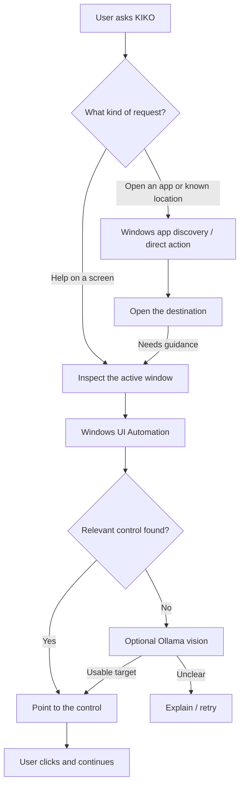

<div align="center">

# KIKO

**A little help with the screen in front of you.**

A Windows assistant for people who find everyday computer tasks harder than they should be.

English · తెలుగు · हिन्दी

</div>

## Why I started building this

I've seen people around me struggle with computers, not because they can't learn, but because nobody really explains the part they're stuck on.

Maybe they downloaded something and can't find it. Maybe they're trying to connect their headphones. Maybe an app has changed its layout and the button they remember isn't there anymore.

What bothers me most is how quickly that turns into frustration. People start worrying that they'll click the wrong thing, or feel awkward asking for help with something that seems simple to everyone else.

And the usual answer is often *“just go to Settings”* or *“click the icon on the left.”* That only works if you already know where those things are.

That's where KIKO came from. I wanted to build something you could talk to normally, in a language you're comfortable with, that would **show you where to go on your actual screen** instead of giving you another paragraph of instructions.

I also don't want it to do everything *for* the person. If KIKO helps you find a button today, ideally you'll recognize it yourself tomorrow.

## What it does right now

You can type a request, or use the microphone in a supported browser. KIKO currently has three ways of helping:

**1. Get you to the right place.**

It can open supported Windows Settings pages, find installed apps using the Windows app list, open a browser tab, or show the Downloads folder. You don't have to know which menu to start from.

**2. Help with the screen that's open.**

KIKO tries to read the controls Windows exposes, work out which one is relevant, and move the pointer to it with a highlight. If those controls aren't readable, it can try a local vision model instead.

**3. Let you do the clicking.**

It explains the next step and leaves the action to you. There are hints, a way to check again, and local practice history. The learning part is still early, but it's something I care about building properly.

### A few things you can ask

| Say or type | What KIKO tries to do |
| --- | --- |
| `Turn on Bluetooth` | Open Bluetooth settings and help locate the switch. |
| `Spotify తెరువు` | Find Spotify among your installed apps and open it. |
| `Open Calculator` | Launch Calculator if Windows can find it. |
| `Find my downloads` | Open Downloads and select the most recently completed file. |
| `Open a new browser tab` | Request a new tab in your default browser. |
| `Help me on this screen` | Inspect the visible app and suggest where to click next. |

Opening an app and navigating *inside* it are different problems. App launching is much more predictable; on-screen guidance is the experimental part.

## How I built it

I separated the application into two paths because I didn't want every simple request to depend on an AI model responding.



For an app-opening request, KIKO checks Windows' registered Start apps and shortcuts instead of keeping a hardcoded list of supported applications. If multiple apps match, it can offer a choice rather than guessing.

For a screen-guidance request, it checks Windows UI Automation first. That gives actual control names and screen positions when an app exposes them. The pointer highlight is based on those positions, or on a checked coordinate returned by the local vision model.

This is deliberately a **guide**, not an agent that silently clicks through your desktop.

### Tech and project structure

| File / tool | What it's for |
| --- | --- |
| `server.py` | Local Python server and task routing |
| `index.html` | Browser UI, voice input, and conversation flow |
| `apps.py` | Finding and launching installed Windows apps |
| `local_actions.py` | Direct browser and Downloads actions |
| `lessons.py` | Windows Settings tasks and localized guidance |
| `native.py` | Window inspection, accessibility controls, pointer highlight |
| `engine.py` | Picking controls and validating suggested screen coordinates |
| **Ollama + Gemma 3** | Optional local vision for screens that need more interpretation |

The interface is built with HTML, CSS, and JavaScript. The backend is Python. For visual reasoning, I use `gemma3:4b` through Ollama so the project doesn't require a paid cloud AI API key.

## Running KIKO

It's a Windows prototype, so you'll need **Windows 10/11** and **Python 3.11+**.

```powershell
git clone https://github.com/jagruthig2020-ship-it/Kiko.git
cd Kiko
.\START_KIKO.bat
```

The launcher sets up Python dependencies and starts KIKO in your browser. Keep the terminal open while using it.

For optional on-screen AI assistance, install [Ollama](https://ollama.com/) and download the model:

```powershell
ollama pull gemma3:4b
```

Try an app-opening request like `Open Calculator` first. You can use KIKO without Ollama for supported direct actions; unfamiliar-screen guidance may need the model.

## Things I still need to get right

This is **a prototype**, not a finished computer-use agent. I've had requests work and others fail, especially when I tried different phrasing in Telugu or moved into an app whose controls KIKO couldn't understand.

Some specific problems I'm working on:

- Making mixed-language requests more reliable, including Telugu or Hindi around English app names.
- Understanding screens that don't expose normal Windows accessibility controls, especially games and custom interfaces.
- Knowing when a highlighted control is *actually* the right one, instead of confidently pointing somewhere wrong.
- Making the help feel more conversational, and measuring whether repeated practice really reduces how much help someone needs.

KIKO doesn't take over sensitive actions like passwords, payments, or sending messages. Visual analysis can be inaccurate, so the person should always check what it's suggesting before clicking.

KIKO's server and Ollama model run locally. **Browser speech recognition may send audio to a browser provider**, depending on the browser, so it isn't accurate to call every part of the voice experience fully offline.

## Where I want to take it

I'd like to sit down with people who genuinely find computers confusing, watch where KIKO helps and where it makes things worse, and build from that feedback.

My biggest question isn't how many apps KIKO can open. It's whether someone who needed help with a task today can do more of it themselves next week.

That's what I'm building toward.
